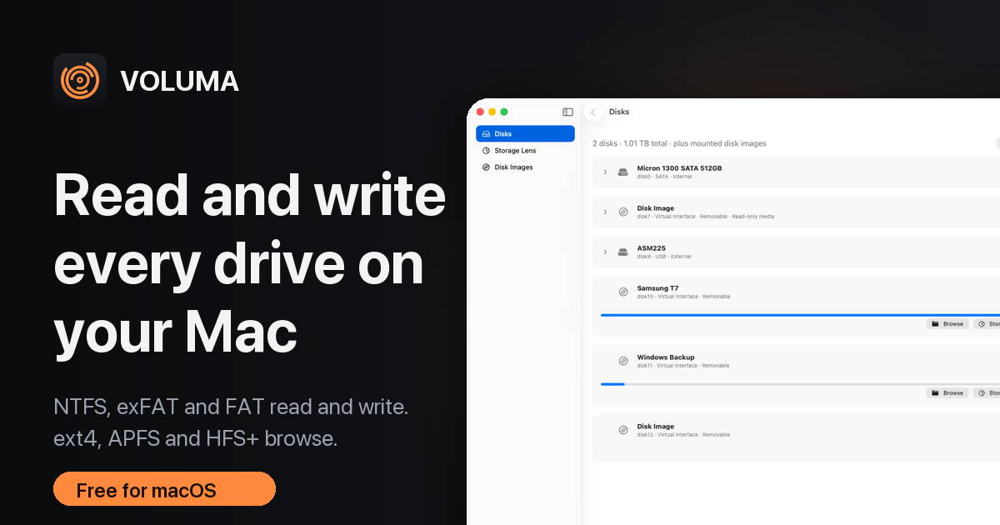
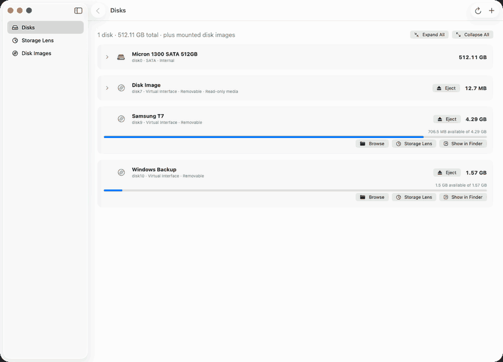

<p align="center"></p>
<h1 align="center">VOLUMA</h1>
<p align="center"><b>Read and write every drive on your Mac.</b><br>A native macOS explorer that writes to NTFS, exFAT and FAT, and browses ext4, APFS and HFS+.</p>
<p align="center">
  <a href="https://github.com/festomanolo/voluma/releases/latest"></a>
  <a href="https://pypi.org/project/nolo-voluma/"></a>
  
  <a href="LICENSE"></a>
</p>

<p align="center"></p>

<p align="center"><br><sub>Writing to an NTFS drive: open it, Enable Writing, paste, done (real recording of the app on a demo volume).</sub></p>

## Install

```bash
pip install nolo-voluma
voluma
```

`voluma` opens the app from any terminal. `voluma install` copies it to `/Applications`. Prefer a download? Grab the zip from the [latest release](https://github.com/festomanolo/voluma/releases/latest), unzip, and drag `VOLUMA.app` to Applications.

> The app is ad-hoc signed and **not notarised yet**. A downloaded zip triggers Gatekeeper: right-click the app and choose Open the first time. Installing with pip avoids that in normal cases, because pip does not mark files as downloaded.

Requires macOS 14 or later. The download is universal (Apple Silicon and Intel), but it was built and tested on an Intel Mac and **the Apple Silicon half has not been run on real Apple Silicon hardware yet**.

## What it does

| | |
|---|---|
| **Write to NTFS** | macOS mounts NTFS read-only. VOLUMA unmounts the volume, asks for your administrator password once, writes through its own NTFS driver, then remounts it. It refuses drives that Windows left dirty or hibernated. |
| **Filesystems** | Read and write: NTFS, exFAT, FAT12/16/32. Read: ext2/3/4, APFS, HFS+/HFSX. |
| **Disks view** | Every disk, partition, APFS container and volume as a collapsible tree, with capacity and free space, read from IOKit and DiskArbitration. Eject external drives from the same screen. |
| **Hyper-fast copy, cut and move** | Between mounted volumes and Finder, in parallel: a worker pool copies thousands of small files at once and splits big files into chunks. Copy on one APFS volume is an instant clone, and move on one volume is an instant rename. Cross-volume cut deletes each source file as soon as its copy lands. A name clash never overwrites. Progress, speed and ETA, with Cancel. |
| **Finder, in VOLUMA** | Real Finder icons, Finder tag colours (set them from the menu, they show up in Finder), list and icon views, Quick Look (Space), Get Info, Duplicate, Make Alias, Compress, Open With, drag and drop, filter, show hidden, and Finder's keyboard shortcuts. Favorites in the sidebar open Home, Desktop, Documents and Downloads. |
| **New file** | Create an empty file or start from a template (text, Markdown, JSON, HTML, shell, Python) on any writable volume, including NTFS, exFAT and FAT. ⌥⌘N. |
| **Storage Lens** | Where your space went, by type, with Finder-style drill-down. Scans 3.3 million files in about 50 seconds. |
| **Raw partitions** | Unmounted partitions (an ext4 drive, say) can be browsed through the same helper, read-only unless the driver can write. |

Guides: [write to NTFS on a Mac](https://festomanolo.com/voluma/guides/write-to-ntfs-on-mac/) · [read an ext4 drive on a Mac](https://festomanolo.com/voluma/guides/read-ext4-linux-drive-on-mac/)

## Measured, not claimed

Intel Core i5-10310U, macOS 26.7.1. Drive tests use disk images, a 256 MB file, a warm cache and the median of three runs, so they compare driver efficiency, not drive speed. Scan tests use real folders. Full charts and raw numbers: [festomanolo.com/voluma](https://festomanolo.com/voluma/#benchmarks).

| | VOLUMA | Reference |
|---|---|---|
| Scan 3.3M files (195 GB volume) | 50 s | `du`: 243 s |
| Scan `/Applications` (384k files) | 2.6 s | `du`: 8.9 s |
| NTFS write, 256 MB | 2,140 MB/s | ntfs-3g `ntfscp`: 199 MB/s |
| NTFS read, 256 MB | 5,366 MB/s | ntfs-3g `ntfscat`: 1,261 MB/s |
| ext4 read, 256 MB | 5,794 MB/s | e2fsprogs `debugfs`: 753 MB/s |
| FAT32 read / write | 1,842 / 583 MB/s | macOS: 2,000 / 253 MB/s |
| exFAT small files (2,000) | 175 files/s | macOS: 597 files/s |

Transfer engine, measured on the same Mac (internal SATA SSD, source and destination on the same physical disk, so large files are disk-bound):

| | VOLUMA | Reference |
|---|---|---|
| Copy 10,001 small files across volumes | 3.9 s | `cp -R`: 15.5 s, `ditto`: 13.4 s |
| Copy 10,001 files within one APFS volume | 2.2 s (clones) | |
| Copy a 1 GB file within one APFS volume | instant (clone) | |
| Move a folder within one volume | 11 ms (rename) | |
| Copy 1.3 GB of large files across volumes | 230 to 370 MB/s | `cp`: 240 to 320 MB/s (same disk, so no gain) |

Large files are limited by the disk, not by the copy loop. The parallel gains show up with many files, and with clone and rename. Reproduce with `tests/bench/fasttransfer.sh`; correctness tests are in `tests/bench/fasttransfer_test.sh`.
The last row is where VOLUMA loses: macOS creates many small files on exFAT faster. Reproduce everything with `tests/bench/run.sh` and `tests/bench/scan.sh`.

## How it is built

A Rust workspace holds the storage engine. A SwiftUI app sits on top through a small JSON-over-C-ABI boundary, so the front end never receives a device handle.

| Crate | Role |
|---|---|
| `block-device` | `BlockDevice` trait, image and device backends, bounded partition windows |
| `partition-manager`, `filesystem-detection` | MBR/GPT parsing and signature-based identification |
| `fs-fat`, `fs-exfat`, `fs-ntfs` | read and write drivers |
| `fs-ext`, `fs-apfs`, `fs-hfsplus` | read-only drivers |
| `voluma-ffi` | the C ABI (`staticlib` + `cdylib`) the macOS and Linux apps call |
| `voluma-helper` | the privileged helper (macOS `getpeereid` & Linux `SO_PEERCRED`) |
| `apps/macos` | SwiftUI app: disk discovery, Storage Lens, browser, copy and paste |
| `apps/linux` | GTK 3 Linux / Light OS app + CLI: disk discovery (`lsblk`), Storage Lens, browser, copy and paste |

### The privileged helper

Raw device nodes need root, so writing to a real NTFS drive goes through `voluma-helper`. It serves exactly one device fixed at launch, over a Unix socket that only your user can open (the peer uid is checked on every connection). It touches host files only by bare name inside a per-session staging folder, with `O_NOFOLLOW`, and refuses anything that is not a regular file you own. It flushes the device after every write and exits when the app does. If the device node is already writable by you (disk images are), no password is asked. See [the safety model](docs/SECURITY.md).

## Safety and honesty

- Writes need a read-write device **and** a clean volume. NTFS also checks the dirty bit, `$LogFile` and Windows hibernation. FAT and exFAT check their dirty flags.
- File data is written first, then bitmaps, then the file record, and the directory entry last. A failed copy releases what it allocated.
- Paste never overwrites. Delete on a mounted volume goes to the Trash.
- **NTFS writing is verified against ntfs-3g (`ntfsresize -i -f`, `ntfscat`, `ntfsls`) and against corrupted disks, but not against Windows `chkdsk`.** Back up anything you cannot replace.
- Not supported: compressed or encrypted NTFS files, files with hard links, alternate data streams, Btrfs, XFS, ZFS, and writing to ext4, APFS or HFS+. The MFT can grow but directory indexes can keep empty blocks after heavy deletes.
- The helper is launched from inside the app bundle. That is development-grade: a distributable build should install a Developer ID-signed helper with `SMAppService`, which is not done.

Details: [filesystem support and limits](docs/FILESYSTEM_SUPPORT.md).

## Build and test

```bash
cargo test --workspace                 # drivers, FFI, helper
apps/macos/build.sh && apps/macos/.build/release/Voluma   # build and run the macOS app + helper
apps/macos/package.sh                  # universal, ad-hoc signed VOLUMA.app + zip in target/dist
apps/linux/build.sh && apps/linux/voluma                  # build and run the Linux GTK 3 app + helper
apps/linux/install.sh [DESTDIR]        # install VOLUMA into Linux / or a Light OS rootcopy tree
pypi/build.sh                          # the nolo-voluma wheel around that app
```

Driver tests are judged by independent implementations, never by themselves: macOS (`fsck_msdos`, `fsck_exfat`, real mounts) for FAT, exFAT, HFS+ and APFS, e2fsprogs (`mke2fs`, `e2fsck`) for ext4, and ntfs-3g for NTFS. `tests/fixtures/build_ntfs3g.sh` and `build_e2fsprogs.sh` build those tools, then set `VOLUMA_NTFS3G` and `VOLUMA_E2FSPROGS`; without them the NTFS and ext4 tests skip with a message. See [testing](docs/TESTING.md).

## Contributing

Issues and pull requests are welcome, especially bug reports from real Windows and Linux drives, and Apple Silicon results. Please include the filesystem, how the drive was last used, and what VOLUMA reported.

## Licence

MIT. See [LICENSE](LICENSE). Website: <https://festomanolo.com/voluma/>
